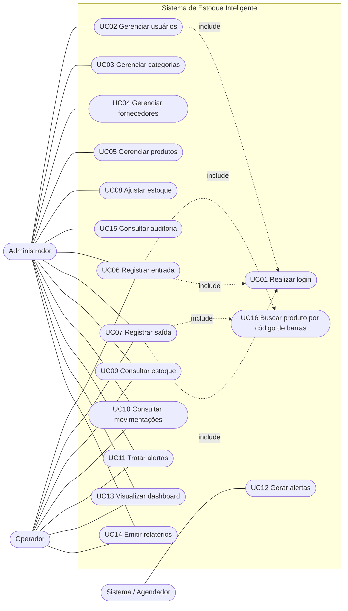

# Sistema de Estoque Inteligente — Modelo de Casos de Uso

## 1. Atores

| Ator | Descrição |
|---|---|
| **Administrador** | Gerencia usuários, cadastros e ajustes de estoque. Acesso total. |
| **Operador** | Opera o dia a dia: consulta estoque, registra entradas e saídas, trata alertas. |
| **Sistema (agendador)** | Ator secundário que gera os alertas automaticamente. |

## 2. Diagrama de casos de uso

> Todo caso de uso, exceto UC12, exige usuário autenticado (UC01). Para legibilidade, o include de UC01 está desenhado só em alguns casos.

## 3. Matriz de permissões

| Caso de uso | Admin | Operador |
|---|:-:|:-:|
| UC01 Login | ✅ | ✅ |
| UC02 Gerenciar usuários | ✅ | ❌ |
| UC03 Categorias (CRUD) | ✅ | 👁 consulta |
| UC04 Fornecedores (CRUD) | ✅ | 👁 consulta |
| UC05 Produtos (CRUD) | ✅ | 👁 consulta |
| UC06 Entrada de estoque | ✅ | ✅ |
| UC07 Saída de estoque | ✅ | ✅ |
| UC08 Ajuste de estoque | ✅ | ❌ |
| UC09 Consultar estoque | ✅ | ✅ |
| UC10 Consultar movimentações | ✅ (todas) | ✅ (todas, somente leitura) |
| UC11 Tratar alertas | ✅ | ✅ |
| UC13 Dashboard | ✅ | ✅ |
| UC14 Relatórios | ✅ | ✅ |
| UC15 Auditoria | ✅ | ❌ |

> Premissa adotada: cadastros mestres são exclusivos do admin. Se o operador também puder cadastrar produtos, basta alterar a matriz.

---

## 4. Especificação dos casos de uso

### UC01 — Realizar login
- **Atores:** Administrador, Operador
- **Pré-condição:** usuário cadastrado e ativo.
- **Fluxo principal:**
  1. Usuário informa e-mail e senha.
  2. Sistema valida a senha comparando com o hash Argon2.
  3. Sistema emite token de acesso (JWT) contendo o perfil.
  4. Sistema registra `ultimo_login` e um evento de auditoria.
- **Fluxos alternativos:**
  - A1. Credenciais inválidas → mensagem genérica, sem indicar qual campo errou.
  - A2. Usuário inativo → acesso negado.
- **Pós-condição:** sessão autenticada com o perfil correto.

### UC02 — Gerenciar usuários
- **Ator:** Administrador
- **Fluxo principal:** listar, criar (nome, e-mail, senha inicial, perfil), editar, redefinir senha, ativar/desativar.
- **Regras:** e-mail único; senha armazenada apenas como hash Argon2; admin não pode desativar a si mesmo; sempre deve existir ao menos um admin ativo.

### UC03 / UC04 — Gerenciar categorias e fornecedores
- **Ator:** Administrador (operador apenas consulta)
- **Fluxo principal:** listar com busca, criar, editar, desativar.
- **Regras:** nome de categoria único; CNPJ do fornecedor com 14 dígitos e único; não excluir registros com produtos vinculados, apenas desativar.

### UC05 — Gerenciar produtos
- **Ator:** Administrador
- **Pré-condição:** existir ao menos uma categoria.
- **Fluxo principal:** informar nome, código de barras, categoria, fornecedor, unidade, estoque mínimo, se controla validade e dias de antecedência do alerta; sistema valida e salva.
- **Alternativos:** A1. Código de barras já cadastrado → erro. A2. Produto com saldo > 0 não pode ser desativado sem confirmação.
- **Regras:** `codigo_barras` único; `estoque_minimo >= 0`.

### UC16 — Buscar produto por código de barras (incluído em UC06 e UC07)
- **Fluxo:** leitor (ou digitação) envia o código → sistema retorna o produto ativo correspondente.
- **Alternativo:** código não encontrado → admin pode ser levado ao UC05; operador recebe aviso.

### UC06 — Registrar entrada de estoque
- **Atores:** Administrador, Operador
- **Pré-condição:** autenticado; produto cadastrado e ativo.
- **Fluxo principal:**
  1. Usuário escaneia o código de barras (UC16).
  2. Informa quantidade, e, quando o produto controla validade, código do lote e data de validade.
  3. Opcionalmente informa fornecedor e nº da nota fiscal.
  4. Sistema, em uma única transação, cria ou atualiza o lote, soma a quantidade e grava a movimentação do tipo `entrada`.
  5. Sistema confirma e mostra o novo saldo.
- **Alternativos:** A1. Quantidade ≤ 0 → erro. A2. Produto exige validade e ela não foi informada → erro. A3. Validade já vencida → pede confirmação.
- **Pós-condição:** saldo atualizado e histórico registrado; alertas de estoque baixo podem ser resolvidos na próxima execução (UC12).

### UC07 — Registrar saída de estoque
- **Atores:** Administrador, Operador
- **Pré-condição:** autenticado; produto com saldo.
- **Fluxo principal:**
  1. Usuário escaneia o código de barras (UC16) e informa a quantidade.
  2. Sistema verifica o saldo total.
  3. Sistema baixa dos lotes pela regra **FEFO** (primeiro a vencer, primeiro a sair), podendo gerar uma movimentação por lote.
  4. Sistema confirma e mostra o saldo restante, avisando se ficou abaixo do mínimo.
- **Alternativos:** A1. Saldo insuficiente → operação rejeitada, nada é gravado. A2. Só restam lotes vencidos → alerta e exige confirmação do admin.
- **Regras:** estoque nunca fica negativo; operação atômica (tudo ou nada).

### UC08 — Ajustar estoque
- **Ator:** Administrador
- **Fluxo principal:** seleciona produto e lote, informa a quantidade correta contada e o **motivo obrigatório** (perda, avaria, inventário...); sistema grava `ajuste_entrada` ou `ajuste_saida` pela diferença.
- **Regra:** todo ajuste gera registro de auditoria.

### UC09 — Consultar estoque
- **Fluxo:** listar produtos com saldo total, categoria, mínimo e situação; filtrar por categoria, fornecedor, estoque baixo e validade; abrir detalhe com lotes.

### UC10 — Consultar movimentações
- **Fluxo:** filtrar por período, produto, tipo e usuário; exibir histórico imutável (quem, quando, quanto, motivo).

### UC12 — Gerar alertas (automático)
- **Ator:** Sistema (agendador, ex.: a cada hora)
- **Fluxo principal:**
  1. Executa `gerar_alertas()`.
  2. Cria alerta `estoque_baixo` quando saldo ≤ mínimo.
  3. Cria alerta `vencimento_proximo` quando faltam ≤ `dias_alerta_vencimento` dias, e `vencido` quando a validade passou.
  4. Resolve automaticamente alertas cujo problema deixou de existir.
- **Regra:** não duplicar alerta enquanto houver um aberto para o mesmo produto/lote/tipo.

### UC11 — Tratar alertas
- **Atores:** Administrador, Operador
- **Fluxo:** listar alertas abertos por tipo e gravidade, marcar como "visto" ou "resolvido" (registrando quem resolveu).

### UC13 — Visualizar dashboard
- **Indicadores:** total de produtos ativos, itens em estoque baixo, lotes a vencer (7/15/30 dias), lotes vencidos, entradas × saídas por dia, produtos mais movimentados, últimas movimentações, alertas abertos.

### UC14 — Emitir relatórios
- **Relatórios:** posição atual de estoque, movimentações por período, produtos abaixo do mínimo, produtos a vencer/vencidos, movimentação por usuário, produtos por fornecedor.
- **Formato:** tela, com exportação em CSV/PDF.

### UC15 — Consultar auditoria
- **Ator:** Administrador
- **Fluxo:** filtrar `log_auditoria` por usuário, ação, entidade e período.

---

## 5. Regras de negócio

| Cód. | Regra |
|---|---|
| RN01 | Senhas são armazenadas apenas como hash Argon2. |
| RN02 | Perfis: `admin` e `operador`; autorização verificada em toda rota da API. |
| RN03 | Código de barras é único por produto. |
| RN04 | Estoque nunca pode ficar negativo. |
| RN05 | Movimentações são imutáveis; correções são feitas por ajuste. |
| RN06 | Saídas seguem FEFO. |
| RN07 | Ajustes exigem motivo e geram auditoria. |
| RN08 | Cadastros com histórico são desativados, nunca excluídos. |
| RN09 | Alerta de estoque baixo quando saldo ≤ estoque mínimo. |
| RN10 | Alerta de vencimento quando faltam ≤ N dias (configurável por produto). |

## 6. Sugestão de mapeamento para o plano de testes

| Área de teste | Casos de uso |
|---|---|
| Login e permissões | UC01, UC02, matriz da seção 3 |
| Cadastros | UC03, UC04, UC05 |
| Movimentações | UC06, UC07, UC08, UC16 |
| Alertas | UC11, UC12 |
| Dashboard e relatórios | UC09, UC10, UC13, UC14 |
